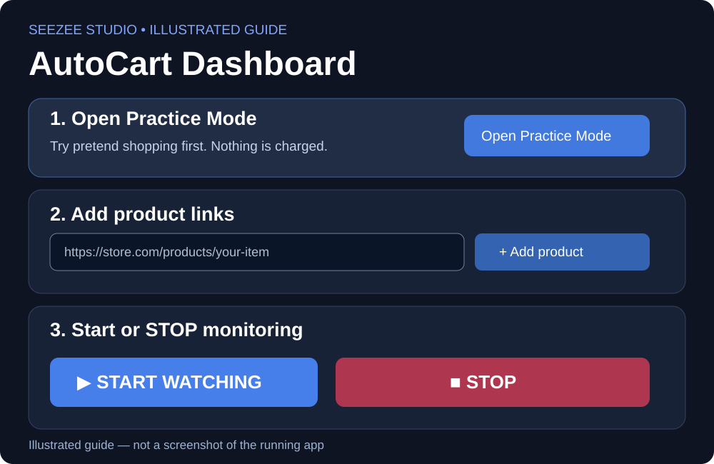
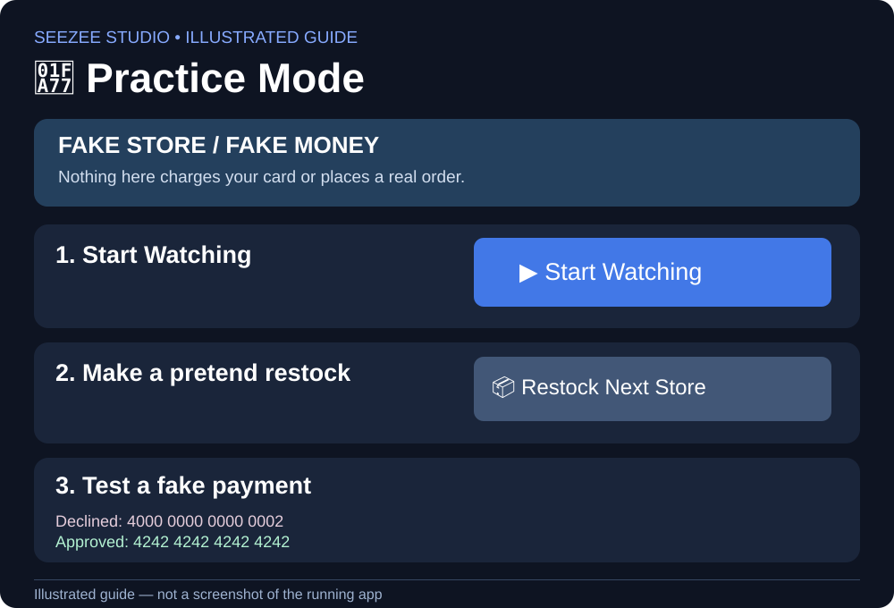

# 🛍️ AutoCart by SeeZee — START HERE

**No coding. No terminal. No credit-card information needed.**

## Chase: the 5 steps

1. **Download the Windows installer** from the **AutoCart Windows installer** build on GitHub, or from the installer link Sean sends you. The file ends in `.exe`. Don't download the green **Code → ZIP**: that's source code, not an app.
2. **Double-click the installer**, follow the setup prompts, and open **AutoCart by SeeZee** from your desktop.
3. **Click “Open Practice Mode” first.** It's fake shopping with pretend cards and pretend restocks. Nothing gets charged.
4. When you're ready, **paste a product link**, give it a name, and click **Add product**. Add more links from other stores as needed.
5. Click **▶ Start watching**. Keep your PC awake. When an item says “Possibly available,” click **Open store** and complete checkout yourself. Click the big **■ STOP** button to stop monitoring at any time.





## Important things to know
- **This is a prototype. It does not make purchases automatically.** You must finish orders on the retailer's checkout page.
- The budget and quantity controls are **planning settings**, not a restriction on the store checkout.
- Status is **best effort**: retailer pages vary and may block bots or report availability unclearly.
- The app only accepts HTTPS product links, uses a separate Chrome/Edge browser profile, and doesn't request payment details.
- Practice Mode is offline and uses pretend cards only. No real payments or order submissions.
- The installer is currently **unsigned**. Windows might warn about an unknown publisher. Do not ignore security warnings blindly; verify the download comes from Sean's GitHub project.
- A Windows PC with Google Chrome or Microsoft Edge is required for live monitoring.

## Feature checklist
| Feature | What it does |
| --- | --- |
| Add multiple stores | Paste as many as 100 HTTPS product links |
| Start | Begin checking each page every 1–60 minutes |
| Stop | Cancel future checks and close active check pages |
| Possible restock alert | Shows a message when a product *might* be available |
| Open store | Opens the product page in a browser for manual checkout |
| Save settings | Keeps the watch list and preferences locally |
| Practice Mode | Simulated restocks, approved/declined test payments, and spending limits |
| Purchasing | **Not yet supported in real stores** |

## For Sean — building an EXE
The source code is in `autocart/`. On a Windows PC:

```powershell
cd autocart
npm install
npm run check
npm test
npm run dist:win
```

The result is in `autocart/dist/`.

The **AutoCart Windows installer** GitHub Actions workflow also builds on Windows. On PRs it uploads an installer as a workflow artifact. Artifacts generally require GitHub login and downloading/extracting a ZIP first; they are **not** the final one-click release. A GitHub Release with a direct EXE asset is the best delivery option for Chase, once tested and signed.

## Security and current limitations
Read `SECURITY.md` for a threat model and what's implemented versus outstanding. No site restrictions, CAPTCHAs or anti-bot challenges should be bypassed. Do not use the app to put real card information into custom forms.